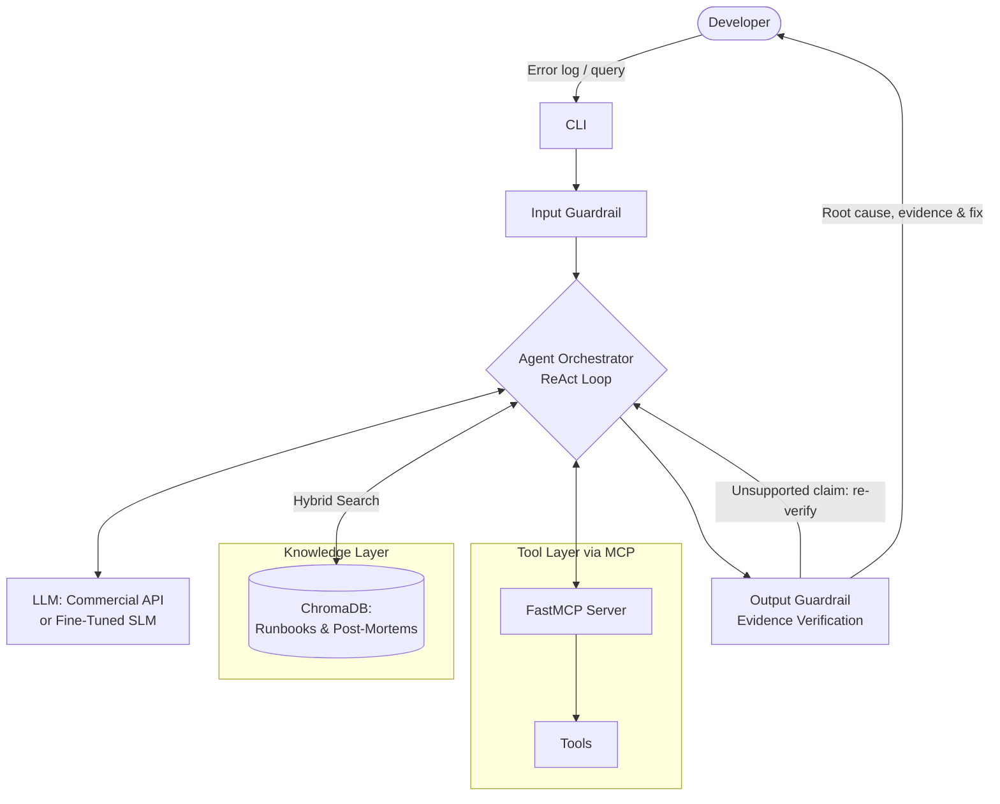
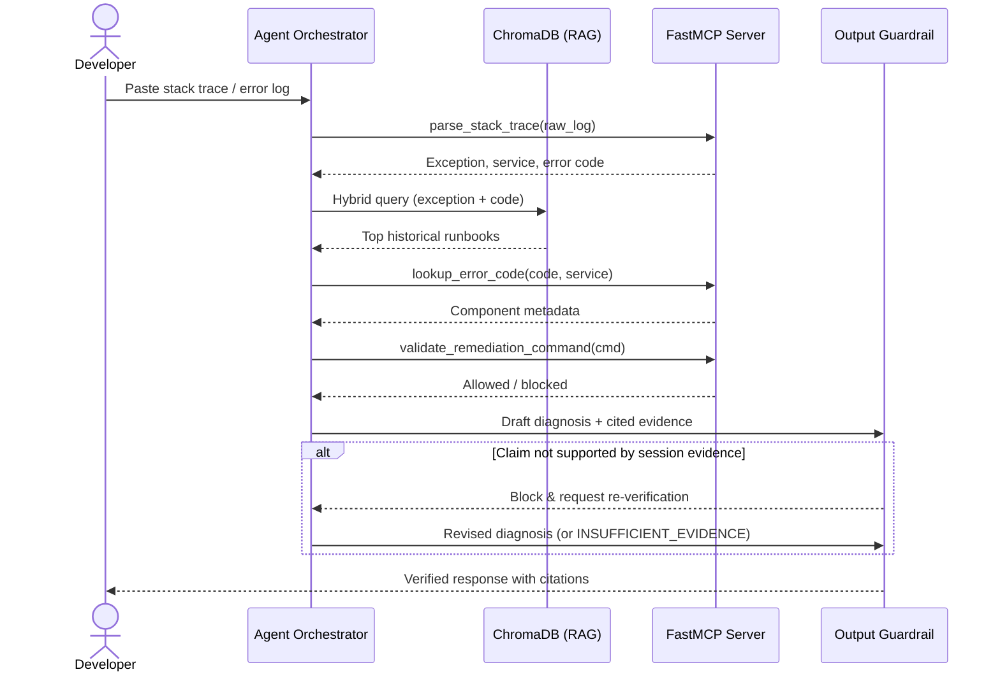

# Milestone 2: System Architecture & Implementation Plan — RootCause

## 1. System Architecture Overview

RootCause is an on-demand diagnostic agent designed to assist backend engineers in triaging exceptions, stack traces, and infrastructure anomalies. Rather than acting as a heavyweight, continuous monitoring daemon, the system operates on a request-driven agentic loop triggered when a developer submits an error payload.

### High-Level Component Diagram

### On-Demand Execution Sequence

## 2. Problem, Data & Dynamic Ingestion

### Task Definition

When a user inputs a raw backend error log, exception trace, or symptom description, RootCause must:

1. Extract key failure signatures (error codes, exception type).
2. Retrieve relevant architectural context and historical post-mortems.
3. Deterministically verify parameters using external diagnostic tools.
4. Output a structured remediation plan containing the Root Cause, Evidence/Citations, and a Safe Remediation Plan — or explicitly report insufficient evidence when the case is not covered by the knowledge base or tools.

### Dataset Composition & Future Scalability

To ensure high quality and rapid iteration during initial development, the application will start out focused and lightweight, documenting at least 12 core backend failure scenarios (target: 16). Each Markdown runbook follows a standardized structure: Service Overview, Common Error Signatures, Root Cause Analysis, and Playbook Remediation.

Because the ingestion and retrieval architecture is completely decoupled from the size of the corpus, the system is designed for seamless horizontal scalability: as new microservices or failure modes emerge in the future, additional runbooks and post-mortems can be added without modifying the codebase.

### Support for New Data Ingestion

To support continuous expansion without manual database rebuilds, we implement an automated ingestion module:

- **Document Hashing:** Each uploaded Markdown or JSON log file is hashed (SHA-256) and tracked in a lightweight SQLite metadata table.
- **Incremental Upsert:** When new files are added to the knowledge base, the pipeline detects only new or modified files, chunks them, computes embeddings, and performs an incremental upsert into the vector store.

## 3. Golden Dataset (GD) Construction

To evaluate RAG retrieval, tool-calling accuracy, evidence grounding, and SLM fine-tuning objectively, we will start with a high-precision Golden Dataset of at least 32 curated test cases (target: 40), directly mapped to the initial failure scenarios. This dataset is designed to grow proportionally alongside the knowledge base as new failure scenarios are ingested over time.

The dataset includes 4–6 **out-of-scope (negative) cases** — errors not covered by any runbook or tool registry — to test that the agent abstains instead of inventing a cause.

For our experiments, the dataset is split into 60% reference/adaptation examples (used to guide synthetic fine-tuning dataset generation) and 40% held-out evaluation cases (strictly reserved for testing). Negative cases are distributed across both splits.

### Schema Design

Each entry in the Golden Dataset adheres to the following strict JSON schema:

- `id`: Unique identifier (e.g., INC-001).
- `user_input`: Raw stack trace, log snippet, or developer query.
- `in_scope`: Boolean; `false` for negative cases where the expected outcome is `INSUFFICIENT_EVIDENCE`.
- `expected_retrieved_docs`: List of target document IDs that the RAG pipeline must retrieve (empty for negative cases).
- `expected_tool_calls`: Ordered list of MCP tool names and arguments the agent should invoke.
- `ground_truth_diagnosis`: Concise explanation of the root cause (or `INSUFFICIENT_EVIDENCE`).
- `expected_evidence_mapping`: Explicit mapping showing which claim of the diagnosis comes from RAG (e.g., `[Doc: RUNBOOK-PG-01#Connection-Leak]`) vs. MCP tool output (e.g., `[Tool: lookup_error_code -> SQLSTATE 53300]`).
- `ground_truth_remediation`: Verified step-by-step fix or CLI command.

### Creation Methodology

We will use a Collaborative Human-in-the-Loop workflow:

1. **Seed Creation:** Each of the 4 team members manually writes 4 realistic backend failure scenarios and 8–10 corresponding Golden Dataset test entries (covering clean logs, noisy stack traces, and at least one out-of-scope case).
2. **Peer Review:** Every entry is cross-checked via Pull Request by another teammate to verify that the `expected_tool_calls`, `expected_evidence_mapping`, and `ground_truth_remediation` are 100% accurate, and that every claim in `ground_truth_diagnosis` is traceable to a cited source.
3. **Proportional Scaling:** Whenever a new runbook is ingested into the system, a corresponding batch of test cases is appended to `golden_dataset.json` to maintain evaluation coverage.

## 4. RAG Pipeline Design & Rationale

Technical documentation and stack traces fail under naive fixed-size character chunking because splitting a stack trace or CLI command mid-block destroys its semantic meaning. Furthermore, error codes (e.g., `SQLSTATE 53300` or `HTTP 502`) require exact lexical matching alongside semantic understanding.

| Component | Design Choice | Rationale & Planned Comparison Experiment |
|---|---|---|
| Chunking Strategy | Markdown-Header Aware Splitting (`MarkdownHeaderTextSplitter` + recursive fallback at 512 tokens, 64-token overlap) | Preserves logical sections (`## Symptoms`, `## Resolution`) intact so code blocks and remediation steps are never severed from their parent error heading. Each chunk stores its `doc_id` and section anchor so citations can point to a specific section. **Experiment:** Benchmark Header-Aware splitting against Naive Fixed-Size (500 chars) chunking on Retrieval Recall@3. |
| Embedding Model | `BAAI/bge-small-en-v1.5` (384 dimensions) | Strong performance-to-size ratio on the MTEB leaderboard. Runs locally on CPU in milliseconds, requires zero API costs, and leaves GPU VRAM free for SLM inference. |
| Vector Database | ChromaDB (Persistent Local Mode) | Stores embeddings directly on disk without requiring heavy container orchestration, making local development and CI evaluation reproducible across all 4 team members' machines. |
| Retrieval Approach | Hybrid Search (Dense Vector Search + BM25 Lexical Search via Reciprocal Rank Fusion) | Dense embeddings capture symptom descriptions ("database is hanging"), while BM25 captures exact error codes and exception names (`DeadlockDetectedException`). **Experiment:** Compare Dense-Only RAG vs. Hybrid RAG (Dense + BM25) against the Golden Dataset. |

## 5. Agent Architecture, MCP Server & Guardrails

### Agent Reasoning Loop

The agent follows a constrained ReAct (Reason + Act) loop capped at `max_iterations = 3` to prevent infinite loops on smaller models. Upon receiving an input, the agent decides whether it has enough structured information to query the RAG store directly, or if it first needs to invoke an MCP tool to parse logs or inspect system rules.

### Model Context Protocol (MCP) Server Implementation

We will implement a standalone MCP server using the official Python FastMCP SDK, communicating with our agent client over standard input/output (stdio). Decoupling the tools via MCP ensures our tools are model-agnostic and cleanly separated from the LLM orchestration code.

#### Scope of Active Investigation

In RootCause, "active investigation" means that the agent runs deterministic tools over **static configuration and metadata files** stored in the repository, rather than relying on retrieval alone. These files include an error-code registry (`error_registry.json`), a service topology with call types and timeouts (`topology.json`), and a remediation command allowlist. They stand in for the configuration an engineering team would maintain for its services. The tools do not connect to live production systems, read live telemetry, or execute or analyze application source code; relevant code-level context (e.g., the async worker pattern behind a connection leak) is captured in the runbooks and reaches the agent through RAG. This keeps every tool output reproducible, which is required for objective evaluation against the Golden Dataset.

We will expose four deterministic tools on the MCP server (with each team member implementing and testing one tool):

- `parse_stack_trace(raw_log: str) -> dict`: Uses regex and deterministic parsing to strip noise (timestamps, memory addresses) and extract the core exception class, service, failing file, and error code.
- `lookup_error_code(code: str, service: str) -> dict`: Queries a static JSON registry of internal service error codes and per-service configuration (`error_registry.json`), returning the error category, severity level, owning team, and relevant configured limits (e.g., `max_connections_limit`). Returns `{"status": "unknown_code"}` when the code is not registered.
- `check_service_dependencies(service_name: str) -> list`: Traverses a static service-dependency graph (`topology.json`) to identify upstream/downstream services, call type (sync/async), and configured timeouts that might cause cascading failures.
- `validate_remediation_command(command: str) -> bool`: Checks proposed CLI/SQL commands against a static allowlist and blocks destructive patterns (`rm -rf`, `DROP TABLE`, `kubectl delete namespace`).

### Toxicity & Hallucination Guardrails

- **Input Guardrail:** A lightweight keyword/regex filter combined with prompt sanitization strips potential prompt injection attempts and rejects off-topic or toxic inputs before invoking the model.
- **Output & Hallucination Guardrail (Strict Evidence Verification):** The agent's output is enforced via a Pydantic schema (`DiagnosisOutput`) with the following fields:
  - `status`: `DIAGNOSED` or `INSUFFICIENT_EVIDENCE`.
  - `proposed_root_cause`: Decomposed into individual claims.
  - `supporting_evidence`: For each claim, at least one source — a `rag_doc_id` + section anchor + quoted snippet, or an `mcp_tool_output` reference to a tool call executed in the session. A `DIAGNOSED` response must contain at least one RAG citation and one tool citation overall.
  - `confidence_note`: States whether the cause is *verified by current tool output* or *consistent with a historical pattern* (RootCause has no live metrics, so historical post-mortems support but do not prove a cause).
  - `remediation_steps`: Each command must pass `validate_remediation_command`.

  The guardrail runs three deterministic checks: (1) every cited `rag_doc_id` was retrieved in the current session, (2) every quoted snippet is a substring of the cited chunk, and (3) every cited tool output matches a logged tool execution trace. If any claim fails, the response is blocked and the agent is prompted to re-verify. If evidence cannot be found within the iteration cap, the agent must return `INSUFFICIENT_EVIDENCE` with suggested manual checks rather than forcing a citation.

### Evidence-Backed Debugging Walkthrough (How Causes Are Grounded)

To ensure the agent never guesses a root cause, every final diagnosis follows the **Evidence-First Output Schema** above, where each claim explicitly cites a **Tool Observation**, a **Retrieved Document Chunk**, or both.

Below is a sample of the initial debugging cases we will evaluate the agent on, illustrating how proposed causes are supported — and how unsupported claims are caught.

1. **Case 1: PostgreSQL Connection Pool Exhaustion (`INC-001`) — guardrail catch**
   - **Developer Input:** `FATAL: remaining connection slots are reserved for non-replication superuser connections (SQLSTATE 53300) at OrderService.db.connect()`
   - **Tool-Generated Evidence (MCP):**
     - `parse_stack_trace` extracts `service="OrderService"`, `error_code="53300"`.
     - `lookup_error_code("53300", "OrderService")` returns deterministic metadata: `{ "category": "Database Capacity", "severity": "SEV-2", "max_connections_limit": 100, "owner": "Checkout-DB-Team" }`.
   - **Retrieved Evidence (RAG):**
     - Hybrid search queries `"OrderService SQLSTATE 53300 connection slots"` and retrieves `RUNBOOK-PG-01.md` (*Section: Connection Leak in Order Worker*), which documents that unclosed transactions in async workers exhaust the 100-connection pool during traffic spikes.
   - **Draft Output (blocked):** *"OrderService has exhausted its 100-connection PostgreSQL limit, caused by unclosed async database sessions accumulating during retry loops."* — The claim "during retry loops" appears in no retrieved chunk or tool output, so the guardrail blocks it and requests re-verification.
   - **Grounded Root Cause Output (after re-verification):** *"OrderService has exhausted its 100-connection PostgreSQL limit (`[Tool: lookup_error_code=53300]`). This matches the documented pattern of unclosed transactions in async order workers exhausting the pool during traffic spikes (`[RAG: RUNBOOK-PG-01.md#Connection-Leak-in-Order-Worker]`)."*
   - **Confidence note:** Limit exhaustion is verified by tool output; the leak mechanism is consistent with a historical pattern and should be confirmed with `pg_stat_activity`.

2. **Case 2: Cascading Upstream Timeout (`INC-004`)**
   - **Developer Input:** `grpc._channel._InactiveRpcError: StatusCode.DEADLINE_EXCEEDED in PaymentGatewayClient.Authorize()`
   - **Tool-Generated Evidence (MCP):**
     - `parse_stack_trace` extracts `service="PaymentGateway"`, `exception="DEADLINE_EXCEEDED"`, `method="Authorize"`.
     - `check_service_dependencies("PaymentGateway")` traverses `topology.json` and returns: `["FraudDetectionService (sync, caller_timeout=2000ms)", "LedgerDB (async)"]`.
   - **Retrieved Evidence (RAG):**
     - Retrieves post-mortem `PM-2026-04.md`, detailing how cold-start latency in `FraudDetectionService` caused `PaymentGateway` to exceed its 2-second gRPC deadline.
   - **Grounded Root Cause Output:** *"The gRPC deadline exceeded in `PaymentGateway.Authorize()` is most likely a cascading timeout: `FraudDetectionService` is a synchronous dependency called with a 2000ms deadline (`[Tool: check_service_dependencies]`), and a prior incident traced the same error to FraudDetectionService cold-start latency (`[RAG: PM-2026-04.md#Root-Cause]`)."*
   - **Confidence note:** The dependency and timeout are verified by tool output; that FraudDetectionService was slow *in this incident* is not verified — suggested check: FraudDetectionService p99 latency and recent deploys/scale-ups.

3. **Case 3: Out-of-Scope Error (`INC-031`) — abstention**
   - **Developer Input:** `java.lang.OutOfMemoryError: Metaspace in ReportingService`
   - **Evidence:** `parse_stack_trace` extracts `service="ReportingService"`; `lookup_error_code` returns `unknown_code`; hybrid search returns no chunk above the relevance threshold.
   - **Expected Output:** `status = INSUFFICIENT_EVIDENCE`, with general manual checks (heap/metaspace settings, recent class-loading changes) and a note that no runbook covers this failure.

### Evidence-Grounding Evaluation

We evaluate the agent on a fixed set of 10 debugging cases drawn from the held-out split (8 in-scope, 2 out-of-scope) and report, per case, how each proposed cause is supported. The same set is re-run for every model tier so results are directly comparable.

| Metric | Definition | How Measured |
|---|---|---|
| Cause Accuracy | Proposed root cause matches `ground_truth_diagnosis` | LLM-as-judge + manual spot check |
| Snippet Fidelity | % of quoted RAG snippets that are substrings of the cited chunk | Deterministic string match |
| Attribution Precision / Recall | Cited sources vs. `expected_evidence_mapping` | Set comparison |
| Claim Support Rate | % of individual claims marked "supported" by their cited evidence | Claim-level LLM judge; one teammate manually spot-checks a sample of judgments |
| Abstention Accuracy | % of out-of-scope cases answered with `INSUFFICIENT_EVIDENCE` | Exact label match |
| Guardrail Catch Rate | % of unsupported draft claims blocked before reaching the user | Comparison of draft vs. final outputs in logs |

Each run produces a per-case evidence table (`results/grounding_<model>.md`), for example:

| Case | Proposed Cause | RAG Evidence | Tool Evidence | Supported? | Correct? |
|---|---|---|---|---|---|
| INC-001 | Pool exhaustion from unclosed async sessions | RUNBOOK-PG-01 §Connection Leak in Order Worker | lookup_error_code → 53300, limit = 100 | ✓ (after re-verify) | ✓ |
| INC-004 | Cascading timeout from FraudDetectionService | PM-2026-04 §Root Cause | check_service_dependencies → sync, 2000ms | ✓ (historical pattern) | ✓ |
| INC-031 | INSUFFICIENT_EVIDENCE | — | lookup_error_code → unknown_code | n/a | ✓ |
| … | | | | | |

Unsupported claims are logged together with the guardrail's decision (blocked / passed), which also feeds Exp 2.

## 6. Model Choices & Fine-Tuning Strategy

To progress systematically toward the Grade 10 requirement, we use a 3-tier model strategy:

**Tier 1 — Commercial Baseline:** GPT-4o-mini (or Gemini 1.5 Flash)
Rationale: Used early on to validate the end-to-end RAG + MCP architecture and assist in generating synthetic instruction-tuning traces mapped from our training split.

**Tier 2 — Base SLM:** Qwen-2.5-7B-Instruct (4-bit quantized)
Rationale: We selected Qwen-2.5-7B-Instruct (with Llama-3.1-8B-Instruct or Phi-3.5-mini-instruct as secondary candidates) because Qwen-2.5 excels at structured JSON output, code comprehension, and native tool-calling syntax. In 4-bit quantization, it fits comfortably within a free Google Colab T4 GPU (16GB VRAM) or local Ollama instance.

**Tier 3 — Fine-Tuned SLM:** Qwen-2.5-7B-Instruct + QLoRA Adapter
Rationale: Out-of-the-box SLMs frequently hallucinate tool arguments or fail to adhere strictly to custom JSON schemas when combining RAG context with MCP tool outputs. We will fine-tune the model using Unsloth (QLoRA, rank r=16, α=32) on 150–200 synthetic reasoning traces expanded from our core scenarios, including traces that demonstrate per-claim citation and `INSUFFICIENT_EVIDENCE` abstention. Unsloth reduces VRAM usage by 60% and speeds up training 2x.

## 7. Equal-Workload Weekly Plan & Commit Schedule

Rather than siloing team members into rigid individual specialties, all 4 team members share ownership across the entire stack. Every week's deliverable is broken into equal parallel tasks so that every member understands the full pipeline (RAG, MCP, Agent, and Fine-Tuning) and pushes meaningful commits to GitHub every single week.

All development, fine-tuning, and experiments conclude by Week 12 ahead of the repository progress audit, leaving Weeks 13 and 14 exclusively for presentation preparation and live demo rehearsals. Each week ends with concrete artifacts committed to the repository (listed in the last column), so progress can be checked directly against this plan.

| Week | Focus Area | Shared Team Tasks (Divided Equally Across All 4 Members) | Planned Experiments | Verifiable Artifacts in Repo |
|---|---|---|---|---|
| Week 6 | Milestone 2 & Repo Setup | • Finalize and commit `docs/Architecture_and_Plan.md`. • Set up boilerplate repository structure and shared `requirements.txt`. • Commit shared interfaces: `DiagnosisOutput` schema, tool signatures, Golden Dataset JSON schema. | — | `docs/Architecture_and_Plan.md`, `src/schemas.py`, `requirements.txt` |
| Week 7 | Core Dataset, Golden Dataset v1 & Ingestion | • Each member writes 3–4 Markdown failure runbooks (at least 12 total) and 8–10 Golden Dataset test cases (at least 32 total, including 4–6 out-of-scope cases) with `expected_evidence_mapping`. • Create the static config files used by the tools (`error_registry.json`, `topology.json`, command allowlist). • Collaboratively implement and test the incremental ingestion script and ChromaDB setup. | — | `data/runbooks/*.md`, `data/golden_dataset.json`, `data/config/*.json`, `src/ingest.py`, merged peer-review PRs |
| Week 8 | Hybrid RAG & Standalone MCP Server | • Build the ChromaDB + BM25 hybrid retriever and run retrieval evaluation scripts. • Set up the FastMCP server, implement and write unit tests for the 4 diagnostic tools. | Exp 1 (RAG): Evaluate Naive Chunking + Dense Search vs. Header Chunking + Hybrid Search on Recall@3. | `src/retriever.py`, `src/mcp_server.py`, `tests/test_tools.py`, `results/exp1_retrieval.md` |
| Week 9 | Agent Loop, Commercial Baseline, Guardrails & Grounding Eval | • Build the ReAct orchestrator connecting the MCP client and RAG pipeline using the Commercial API baseline. • Implement input sanitization, Pydantic `DiagnosisOutput` validation, snippet/citation checks, and command guardrails. • Build the grounding evaluation script and publish the first per-case evidence table. | Exp 2 (Guardrails): Measure hallucination and unsafe command blocking rate with and without output guardrails. Exp 2b (Grounding): Run the 10-case evidence-grounding evaluation on the Commercial baseline. | `src/agent.py`, `src/guardrails.py`, `eval/grounding_eval.py`, `results/exp2_guardrails.md`, `results/grounding_commercial.md` |
| Week 10 | Base SLM Integration & Prompt Experiments | • Integrate the un-tuned Base SLM (Qwen-2.5-7B-Instruct) via Ollama/Colab and extend the automated evaluation script. • Run and log the prompting strategies against the Golden Dataset. | Exp 3 (Prompts): Benchmark Zero-Shot vs. Few-Shot + Strict-JSON prompts on the Golden Dataset, including Claim Support Rate and Abstention Accuracy. | `results/exp3_prompts.md`, `results/grounding_base_slm.md`, logged run outputs |
| Week 11 | SLM QLoRA Fine-Tuning | • Collaboratively generate and review ~150–200 ChatML training traces from our core scenarios. • Configure and execute the Unsloth QLoRA fine-tuning notebook and export a first LoRA adapter. | Exp 4 (Models) started: first evaluation of the Fine-Tuned SLM on the held-out split. | `data/finetune/traces.jsonl`, `notebooks/finetune_unsloth.ipynb` (executed), adapter checkpoint or download link, training logs |
| Week 12 | Integration, Final Experiments & Code Freeze | • Plug the fine-tuned SLM into the agent and complete Exp 4. • Build the final CLI entry point, finalize evaluation charts and grounding tables. • Buffer for fixes and retraining if needed. All code, experiments, and documentation completed. | Exp 4 (Models) completed: Commercial LLM vs. Base SLM vs. Fine-Tuned SLM on tool-calling accuracy, diagnosis quality, and evidence-grounding metrics. | `results/exp4_models.md`, `results/grounding_finetuned.md`, charts, updated README |
| Week 13 | Presentation & Demo Preparation I | • Synthesize experimental findings, architecture diagrams, and ablation tables into the final presentation deck. • Prepare scripted demo scenarios showing how the system scales when a new runbook is ingested on the fly, and how the guardrail blocks an unsupported claim. | — | Presentation deck, demo script |
| Week 14 | Final Presentation & Live Demo | • Conduct full team rehearsal of the presentation and Q&A. • Deliver final presentation and live demonstration of RootCause using the fine-tuned SLM. | — | — |

### Stretch Goals (Optional, If Time Permits)

The items below are not part of the committed scope. They will be added only after all committed deliverables for the corresponding week are complete.

- **FastAPI endpoint** in addition to the CLI.
- **Additional prompting strategies** in Exp 3 (Chain-of-Thought, and Chain-of-Thought + Strict-JSON).
- **Inter-rater agreement:** a second human rater on the Claim Support Rate sample, reporting agreement with the LLM judge.
- **Extended corpus:** growing the knowledge base to 16 runbooks and the Golden Dataset to 40 cases.
- **Secondary SLM candidate:** repeating Exp 4 with Llama-3.1-8B-Instruct or Phi-3.5-mini-instruct.
