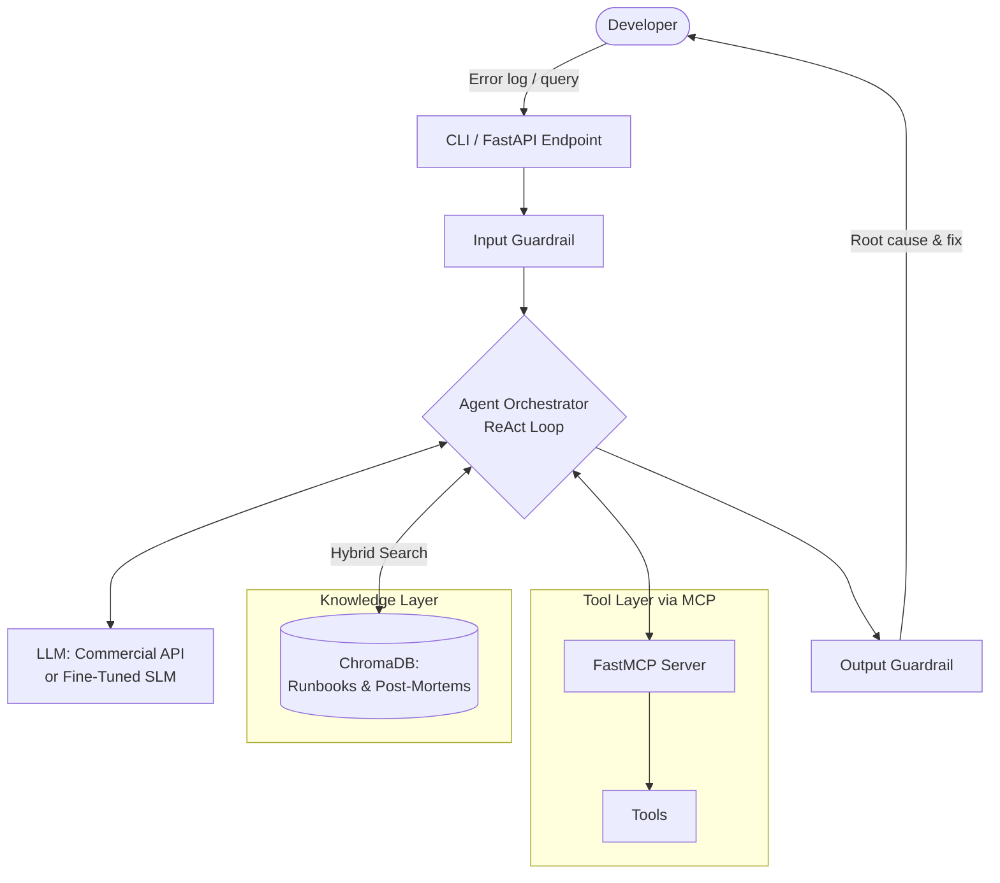
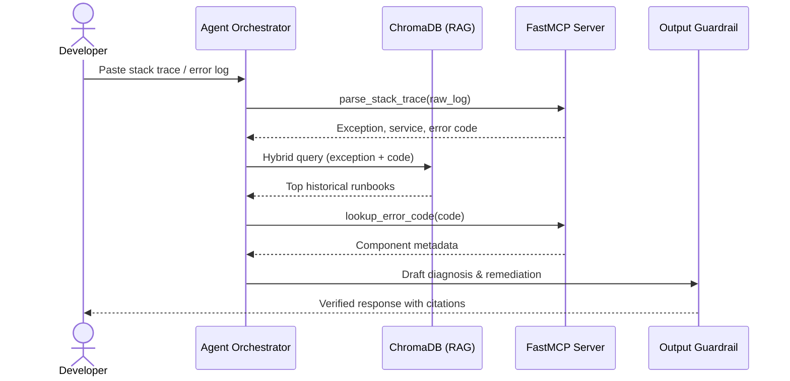

# Milestone 2: System Architecture & Implementation Plan — RootCause

## 1. System Architecture Overview

RootCause is an on-demand diagnostic agent designed to assist backend engineers in triaging exceptions, stack traces, and infrastructure anomalies. Rather than acting as a heavyweight, continuous monitoring daemon, the system operates on a request-driven agentic loop triggered when a developer submits an error payload.

### High-Level Component Diagram

### On-Demand Execution Sequence

## 2. Problem, Data & Dynamic Ingestion

### Task Definition

When a user inputs a raw backend error log, exception trace, or symptom description, RootCause must:

1. Extract key failure signatures (error codes, exception type).
2. Retrieve relevant architectural context and historical post-mortems.
3. Deterministically verify parameters using external diagnostic tools.
4. Output a structured remediation plan containing the Root Cause, Evidence/Citations, and a Safe Remediation Plan.

### Dataset Composition & Future Scalability

To ensure high quality and rapid iteration during initial development, the application will start out focused and lightweight, documenting 12–16 core backend failure scenarios. Each Markdown runbook follows a standardized structure: Service Overview, Common Error Signatures, Root Cause Analysis, and Playbook Remediation.

Because the ingestion and retrieval architecture is completely decoupled from the size of the corpus, the system is designed for seamless horizontal scalability: as new microservices or failure modes emerge in the future, additional runbooks and post-mortems can be added without modifying the codebase.

### Support for New Data Ingestion

To support continuous expansion without manual database rebuilds, we implement an automated ingestion module:

- **Document Hashing:** Each uploaded Markdown or JSON log file is hashed (SHA-256) and tracked in a lightweight SQLite metadata table.
- **Incremental Upsert:** When new files are are added to the knowledge base, the pipeline detects only new or modified files, chunks them, computes embeddings, and performs an incremental upsert into the vector store.

## 3. Golden Dataset (GD) Construction

To evaluate RAG retrieval, tool-calling accuracy, and SLM fine-tuning objectively, we will start with a high-precision Golden Dataset of 32–40 curated test cases, directly mapped to some initial failure scenarios. This dataset is designed to grow proportionally alongside the knowledge base as new failure scenarios are ingested over time.

For our experiments, the dataset is split into 60% reference/adaptation examples (used to guide synthetic fine-tuning dataset generation) and 40% held-out evaluation cases (strictly reserved for testing).

### Schema Design

Each entry in the Golden Dataset adheres to the following strict JSON schema:

- `id`: Unique identifier (e.g., INC-001).
- `user_input`: Raw stack trace, log snippet, or developer query.
- `expected_retrieved_docs`: List of target document IDs that the RAG pipeline must retrieve.
- `expected_tool_calls`: Ordered list of MCP tool names and arguments the agent should invoke.
- `ground_truth_diagnosis`: Concise explanation of the root cause.
- `ground_truth_remediation`: Verified step-by-step fix or CLI command.

### Creation Methodology

We will use a Collaborative Human-in-the-Loop workflow:

1. **Seed Creation:** Each of the 4 team members manually writes 4 realistic backend failure scenarios and 8–10 corresponding Golden Dataset test entries (covering both clean logs and noisy stack traces).
2. **Peer Review:** Every entry is cross-checked via Pull Request by another teammate to verify that the `expected_tool_calls` and `ground_truth_remediation` are 100% accurate.
3. **Proportional Scaling:** Whenever a new runbook is ingested into the system, a corresponding batch of test cases is appended to `golden_dataset.json` to maintain evaluation coverage.

## 4. RAG Pipeline Design & Rationale

Technical documentation and stack traces fail under naive fixed-size character chunking because splitting a stack trace or CLI command mid-block destroys its semantic meaning. Furthermore, error codes (e.g., `SQLSTATE 53300` or `HTTP 502`) require exact lexical matching alongside semantic understanding.

| Component | Design Choice | Rationale & Planned Comparison Experiment |
|---|---|---|
| Chunking Strategy | Markdown-Header Aware Splitting (`MarkdownHeaderTextSplitter` + recursive fallback at 512 tokens, 64-token overlap) | Preserves logical sections (`## Symptoms`, `## Resolution`) intact so code blocks and remediation steps are never severed from their parent error heading. **Experiment:** Benchmark Header-Aware splitting against Naive Fixed-Size (500 chars) chunking on Retrieval Recall@3. |
| Embedding Model | `BAAI/bge-small-en-v1.5` (384 dimensions) | Strong performance-to-size ratio on the MTEB leaderboard. Runs locally on CPU in milliseconds, requires zero API costs, and leaves GPU VRAM free for SLM inference. |
| Vector Database | ChromaDB (Persistent Local Mode) | Stores embeddings directly on disk without requiring heavy container orchestration, making local development and CI evaluation reproducible across all 4 team members' machines. |
| Retrieval Approach | Hybrid Search (Dense Vector Search + BM25 Lexical Search via Reciprocal Rank Fusion) | Dense embeddings capture symptom descriptions ("database is hanging"), while BM25 captures exact error codes and exception names (`DeadlockDetectedException`). **Experiment:** Compare Dense-Only RAG vs. Hybrid RAG (Dense + BM25) against the Golden Dataset. |

## 5. Agent Architecture, MCP Server & Guardrails

### Agent Reasoning Loop

The agent follows a constrained ReAct (Reason + Act) loop capped at `max_iterations = 3` to prevent infinite loops on smaller models. Upon receiving an input, the agent decides whether it has enough structured information to query the RAG store directly, or if it first needs to invoke an MCP tool to parse logs or inspect system rules.

### Model Context Protocol (MCP) Server Implementation

We will implement a standalone MCP server using the official Python FastMCP SDK, communicating with our agent client over standard input/output (stdio). Decoupling the tools via MCP ensures our tools are model-agnostic and cleanly separated from the LLM orchestration code.

We will expose four deterministic tools on the MCP server (with each team member implementing and testing one tool):

- `parse_stack_trace(raw_log: str) -> dict`: Uses regex and deterministic parsing to strip noise (timestamps, memory addresses) and extract the core exception class, failing file, and error code.
- `lookup_error_code(code: str, service: str) -> dict`: Queries a deterministic JSON registry of internal service error codes, returning exact severity levels and owning team metadata.
- `check_service_dependencies(service_name: str) -> list`: Traverses a static service-dependency graph (`topology.json`) to identify upstream/downstream services that might cause cascading failures.
- `validate_remediation_command(command: str) -> bool`: Checks proposed CLI/SQL commands against an allowlist and blocks destructive patterns (`rm -rf`, `DROP TABLE`, `kubectl delete namespace`).

### Toxicity & Hallucination Guardrails

- **Input Guardrail:** A lightweight keyword/regex filter combined with prompt sanitization strips potential prompt injection attempts and rejects off-topic or toxic inputs before invoking the model.
- **Output & Hallucination Guardrail:** Every diagnosis must cite a valid document ID retrieved in the current session context. If the model invents a document ID, the orchestrator intercepts the output and triggers a self-correction prompt or safe fallback.

## 6. Model Choices & Fine-Tuning Strategy

To progress systematically toward the Grade 10 requirement, we use a 3-tier model strategy:

**Tier 1 — Commercial Baseline:** GPT-4o-mini (or Gemini 1.5 Flash)
Rationale: Used early on to validate the end-to-end RAG + MCP architecture and assist in generating synthetic instruction-tuning traces mapped from our training split.

**Tier 2 — Base SLM:** Qwen-2.5-7B-Instruct (4-bit quantized)
Rationale: We selected Qwen-2.5-7B-Instruct (with Llama-3.1-8B-Instruct or Phi-3.5-mini-instruct as secondary candidates) because Qwen-2.5 excels at structured JSON output, code comprehension, and native tool-calling syntax. In 4-bit quantization, it fits comfortably within a free Google Colab T4 GPU (16GB VRAM) or local Ollama instance.

**Tier 3 — Fine-Tuned SLM:** Qwen-2.5-7B-Instruct + QLoRA Adapter
Rationale: Out-of-the-box SLMs frequently hallucinate tool arguments or fail to adhere strictly to custom JSON schemas when combining RAG context with MCP tool outputs. We will fine-tune the model using Unsloth (QLoRA, rank r=16, α=32) on 150–200 synthetic reasoning traces expanded from our core scenarios. Unsloth reduces VRAM usage by 60% and speeds up training 2x

## 7. Equal-Workload Weekly Plan & Commit Schedule

Rather than siloing team members into rigid individual specialties, all 4 team members share ownership across the entire stack. Every week's deliverable is broken into equal parallel tasks so that every member understands the full pipeline (RAG, MCP, Agent, and Fine-Tuning) and pushes meaningful commits to GitHub every single week.

All development, fine-tuning, and experiments conclude by Week 12 ahead of the repository progress audit, leaving Weeks 13 and 14 exclusively for presentation preparation and live demo rehearsals.

| Week | Focus Area | Shared Team Tasks (Divided Equally Across All 4 Members) | Planned Experiments |
|---|---|---|---|
| Week 6 | Milestone 2 & Repo Setup | • Finalize and commit `docs/Architecture_and_Plan.md`. • Set up boilerplate repository structure. | — |
| Week 7 | Core Dataset, Golden Dataset v1 & Ingestion | • Each member writes 3–4 Markdown failure runbooks (12–16 total) and 8–10 Golden Dataset test cases (32–40 total). • Collaboratively implement and test the incremental ingestion script and ChromaDB setup. | — |
| Week 8 | Hybrid RAG & Standalone MCP Server | • Build the ChromaDB + BM25 hybrid retriever and run retrieval evaluation scripts. • Set up the FastMCP server, implement and write unit tests for the 4 diagnostic tools. | Exp 1 (RAG): Evaluate Naive Chunking + Dense Search vs. Header Chunking + Hybrid Search on Recall@3. |
| Week 9 | Agent Loop, Commercial Baseline & Guardrails | • Build the ReAct orchestrator connecting the MCP client and RAG pipeline using the Commercial API baseline. • Implement input sanitization, Pydantic output schema validation, and citation/command guardrails . | Exp 2 (Guardrails): Measure hallucination and unsafe command blocking rate with and without output guardrails. |
| Week 10 | Base SLM Integration & Prompt Experiments | • Integrate the un-tuned Base SLM (Qwen-2.5-7B-Instruct) via Ollama/Colab and build the automated evaluation script . • Each member designs, runs, and logs evaluation metrics for a distinct prompting strategy against the Golden Dataset. | Exp 3 (Prompts): Benchmark Zero-Shot vs. Few-Shot vs. Chain-of-Thought vs. Strict-JSON prompts on the Golden Dataset. |
| Week 11 | SLM QLoRA Fine-Tuning | • Collaboratively generate and review ~150–200 ChatML training traces from our core scenarios. • Configure and execute the Unsloth QLoRA fine-tuning notebook, export the LoRA adapter, and plug the fine-tuned SLM into the agent. | Exp 4 (Models): Compare Commercial LLM vs. Base SLM vs. Fine-Tuned SLM on tool-calling accuracy and diagnosis quality. |
| Week 12 | Final Code Freeze & Pre-Holiday GitHub Audit | • All 100% of code, experiments, and documentation completed. • Build clean CLI/FastAPI endpoint, finalize evaluation charts | — |
| Week 13 | Presentation & Demo Preparation I | • Synthesize experimental findings, architecture diagrams, and ablation tables into the final presentation deck. • Prepare scripted demo scenarios showing how the system scales when a new runbook is ingested on the fly. | — |
| Week 14 | Final Presentation & Live Demo | • Conduct full team rehearsal of the presentation and Q&A. • Deliver final presentation and live demonstration of RootCause using the fine-tuned SLM. | — |

